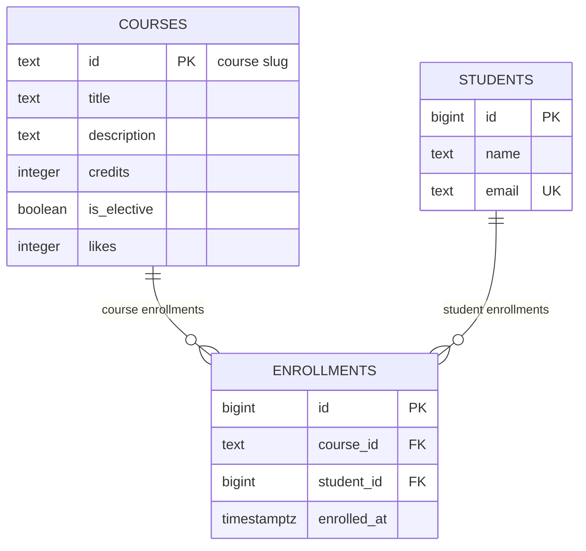

# Course Catalog Database

PostgreSQL schema, initial data, and SQL queries for the Course Catalog labs.

## How to run

PostgreSQL 16 or newer is required. As a PostgreSQL superuser, create the application role and the three databases once:

```sql
CREATE ROLE catalog_app LOGIN PASSWORD 'change-me';
CREATE DATABASE course_catalog OWNER catalog_app;
CREATE DATABASE idx_demo OWNER catalog_app;
CREATE DATABASE norm_demo OWNER catalog_app;
```

From this project folder, create the schema, load the seed data, and test the API queries:

```powershell
psql -h localhost -U catalog_app -d course_catalog -v ON_ERROR_STOP=1 -f schema.sql
psql -h localhost -U catalog_app -d course_catalog -v ON_ERROR_STOP=1 -f seed.sql
psql -h localhost -U catalog_app -d course_catalog -v ON_ERROR_STOP=1 -f queries.sql
```

After loading the seed data, the database contains six courses, three students, and six enrollments.

## Schema



Courses and students are stored separately from enrollments, so each fact has one source of truth. An enrollment joins exactly one course and one student. `ON DELETE RESTRICT` prevents deleting a course with enrollments, while `ON DELETE CASCADE` deletes a student's enrollments when that student is deleted.

## Design decisions

- Course IDs are stable text slugs because they are already used in the API URLs. Student and enrollment IDs are database-generated bigints.
- The enrollment pair `(course_id, student_id)` is unique, so one student cannot enroll in the same course twice.
- `credits`, `likes`, student name, and email are protected by database constraints. Database rules remain valid even if an API validation layer is bypassed.

## Constraint violation log

Run each experiment in psql with `\set VERBOSITY verbose`, record the SQLSTATE and the constraint name, then restore normal output with `\set VERBOSITY default`.

| Case | Expected SQLSTATE | Constraint or column | API response |
|---|---:|---|---|
| Missing course title | 23502 | title | 422 |
| Credits equal to zero | 23514 | courses_credits_check | 422 |
| Negative likes | 23514 | courses_likes_check | 500: application bug |
| One-letter student name | 23514 | students_name_check | 422 |
| Duplicate student email | 23505 | students_email_key | 409 Conflict |
| Duplicate course ID | 23505 | courses_pkey | 409 Conflict |
| Duplicate enrollment pair | 23505 | enrollments_course_id_student_id_key | 409 Conflict |
| Enrollment with missing course | 23503 | enrollments_course_id_fkey | 404 |
| Enrollment with missing student | 23503 | enrollments_student_id_fkey | 404 |
| Delete a course with enrollments | 23001 on PostgreSQL 18, otherwise 23503 | enrollments_course_id_fkey | 409 Conflict |

Pydantic should reject invalid API input before SQL runs. The constraints remain the final data-integrity protection for other clients, scripts, and future code.

## Index experiment

For the before-plan experiment, temporarily comment out the index in `schema.sql`, then run `schema.sql` and `experiments/idx_data.sql` in `idx_demo`.

```sql
EXPLAIN ANALYZE SELECT * FROM enrollments WHERE student_id = 777;
CREATE INDEX enrollments_student_id_idx ON enrollments (student_id);
EXPLAIN ANALYZE SELECT * FROM enrollments WHERE student_id = 777;
```

Record the actual plans and timings from your machine here before submission.

| | Before the index | After the index |
|---|---|---|
| Access method | Seq Scan | Bitmap Index Scan / Bitmap Heap Scan |
| Cost | Record from EXPLAIN | Record from EXPLAIN |
| Rows removed by filter | About 49,997 | 0 |
| Execution time | Record from EXPLAIN ANALYZE | Record from EXPLAIN ANALYZE |

PostgreSQL automatically indexes primary keys and unique constraints, but it does not automatically index a foreign key. The new index speeds up `GET /enrollments` for one student and locating their enrollments during a cascading student deletion. A six-row primary-key lookup can still use a sequential scan because reading one tiny table page is cheaper than using an index.

## Transaction

Enrolling a new student requires two inserts: one into `students`, then one into `enrollments`. In a transaction, a failed second insert aborts the transaction; `ROLLBACK` also removes the first insert, preventing a half-completed operation.

In the successful two-window scenario, the second connection sees no new student before `COMMIT` and sees both the student and enrollment after it. PostgreSQL's default `read committed` isolation exposes only committed data to other clients.

## Self-review

| Check | Result |
|---|---|
| Every table has a primary key | Yes |
| Every relationship has a foreign key | Yes |
| Required values use NOT NULL | Yes |
| Domain rules use CHECK and UNIQUE | Yes |
| Deletion behavior is deliberate | RESTRICT for courses, CASCADE for students |
| Data is normalized | Courses, students, and enrollments are separate facts |
| Foreign-key lookup has an index | `enrollments_student_id_idx` |
